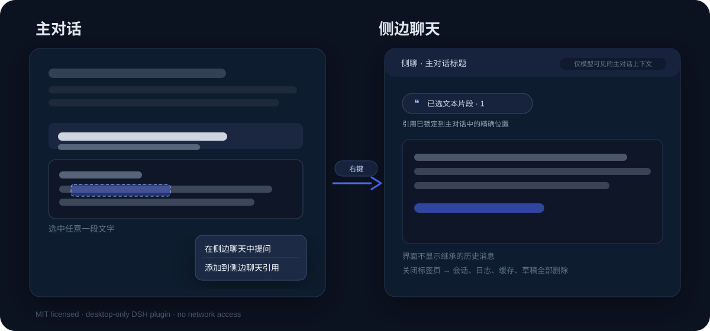

# Quote Ask · dsh-quote-ask

> Quote Ask (引问) for [DeepSeek Harness](https://github.com/deepseek-ai/deepseek-harness) Desktop.
> Select text in the main conversation → right-click → attach it to the next main-chat question or ask a temporary side chat that **sees the main conversation context** but **shows no inherited history**. Close its tab and every side-chat artifact is deleted.

[](./LICENSE)
[](https://github.com/deepseek-ai/deepseek-harness)
[](#compatibility)



## Why

When a conversation gets long, a quick question about one sentence usually
forces a bad trade-off: asking in the main thread pollutes it, and starting a
new conversation makes the model lose all context. This plugin gives you a
third option: a clean temporary side chat that still knows the main conversation
and exactly where your selection came from.

## Features

- **Selection → side chat**: select text in the main conversation, right-click,
  and open a side chat.
- **Add to conversation**: the same context menu attaches the selection to the
  next turn of the main conversation. The main composer shows the same quote
  chip, accepts multiple attachments, opens the quote panel on hover/click, and
  clears them after the answered turn.
- **Clean UI**: the side chat starts blank; the composer sits at the bottom like
  a normal conversation.
- **Exact quote anchors**: DOM node key, turn, character offsets, surrounding
  text, and full message text are captured, so repeated words are resolved to
  the exact occurrence.
- **Model-only main context**: user/assistant text messages, tool-result
  summaries, and quotes are written to `context.md` and injected through a
  scoped system-prompt section. The UI never displays them.
- **Quote chip in the composer**: view, append, and delete individual quotes;
  the panel adapts to fullscreen and window resizing.
- **Deletion is real**: deleting a quote regenerates `context.md` and redacts the
  matching occurrence from the main transcript; re-adding it restores it.
- **No conversation-list pollution**: quote-ask rows are hidden without using
  DSH's archive feature, which would block model steps.
- **Delete on close**: scratch directory, context, session log, projection
  cache, spill data, browser draft, and cleanup proof are removed.
- **Session-scoped lifetime**: fully quitting or restarting DSH deletes every
  side chat left open and purges its saved browser entries/tabs, so nothing is
  left under the ungrouped list on the next launch. A page reload (`Ctrl+R`)
  keeps them because the Host process is still alive.
- **Local only**: no network requests, no telemetry.

## Requirements

- DeepSeek Harness **Desktop**, currently tested with `0.2.1-rc.2` on Windows 11.
- The Desktop profile (the plugin is disabled for web profiles).
- No separate Node install is required; DSH ships its own runtime.

## Install on Windows

```powershell
git clone https://github.com/stilla-maris/dsh-quote-ask.git
cd dsh-quote-ask
powershell -ExecutionPolicy Bypass -File .\scripts\install-windows.ps1
```

If DSH is not in the default location:

```powershell
powershell -ExecutionPolicy Bypass -File .\scripts\install-windows.ps1 -DshRoot "D:\path\to\DeepSeek Harness"
```

Detailed install and troubleshooting: [docs/installation.md](docs/installation.md).

Then **fully quit and relaunch DSH Desktop** (a page refresh is not enough).
The script calls the bundled DSH CLI, which is equivalent to:

```powershell
$dsh = "$env:LOCALAPPDATA\Programs\DeepSeek Harness\resources\runtime\cli\bin\dsh.cmd"
& $dsh plugin --profile desktop add "<absolute path to this repository>"
```

Usage: open a conversation, select text, right-click → “在侧边聊天中提问”
(Ask in side chat), and use the right-sidebar tab. Close the tab to clean up.

## Uninstall

```powershell
powershell -ExecutionPolicy Bypass -File .\scripts\uninstall-windows.ps1
```

Then fully quit and relaunch DSH. Your main conversations are untouched.

## Compatibility

| Environment | Status |
|---|---|
| DSH Desktop 0.2.1-rc.2, Windows 11 | ✅ tested |
| Other DSH 0.2.x Desktop builds | ⚠️ likely, not exhaustively tested |
| DSH 0.3+ | ❌ blocked by `engines`, adaptation needed |
| macOS / Linux | ⚠️ untested; issues/PRs welcome |
| Web / CLI-only DSH | ❌ not applicable |

## Data & privacy

The plugin reads the selected main conversation locally to build
`$DSH_HOME/quote-ask/<id>/context.md`. That context is sent to the model as part
of the quote-ask prompt, just like a normal DSH conversation. The plugin itself
makes no network requests. On close it deletes the quote-ask directory, session
log, projection cache, spill data, browser draft, and the cleanup proof; on a
full DSH quit it also removes every side chat still open. The main conversation
is never modified. See
[docs/cleanup-and-compatibility.md](docs/cleanup-and-compatibility.md) for the
exact list and crash-recovery behavior.

## Development

No build step; the directory is the package.

```bash
node scripts/check.mjs
node test/verify.mjs
```

The contract test uses a temporary `DSH_HOME` and does not need a running DSH.

## License

MIT. This is an independent community project and is not affiliated with
DeepSeek. DeepSeek Harness itself is governed by its own license.
