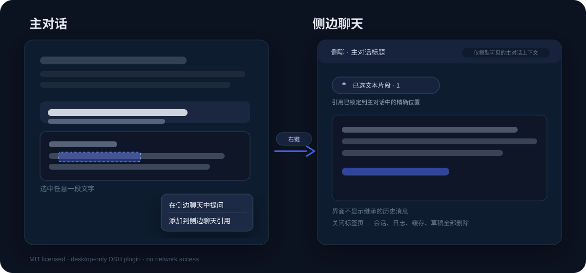

# 引问 · dsh-quote-ask

> 给 [DeepSeek Harness](https://github.com/deepseek-ai/deepseek-harness) Desktop 用的「引用提问」插件：在主对话里选中一段文字，右键即可**添加到下一次主对话提问**，或在右侧开一个临时侧聊——它**带着主对话上下文**回答你选中的内容，但聊天界面**不显示任何继承来的历史**；关掉标签页，侧聊的所有痕迹都会被删除。

[](./LICENSE)
[](https://github.com/deepseek-ai/deepseek-harness)
[](#兼容性)
[](#数据与隐私)



## 为什么做这个

DSH 的主对话很长时，临时想问一个点（「这句话什么意思？」「这个接口为什么这么写？」「这里为什么不用 A 而用 B？」）通常只有两个选择：

- 直接在主线里追问：会污染主线，而且模型容易顺着原对话继续写；
- 开一个新对话：模型不知道你在说什么，得把上下文重新贴一遍。

`dsh-quote-ask` 把这中间的状态做成了一个临时侧聊：它像新对话一样干净，但模型能看到主对话和你精确选中的内容；你问完、关掉，它就从世界消失。

### 和常见侧聊插件的侧重点差异

DSH 社区已经有一些侧聊/分支对话插件，本项目的侧重点是「引用定位」和「删得干净」：

- 引用不是一段孤立文本：记录 DOM 消息节点、轮次、字符偏移、前后文和整条消息，同一个词出现多次也能锁定你选中的那一次；
- 引用管理不是只改 UI：增删都会重写模型上下文，删除还会把主对话转录中对应的那一次出现替换为「〔该引用片段已删除〕」；
- 不做 archive：避免 DSH 的 archived-session gate 拦掉模型调用；
- 关闭后按白名单删除会话目录、日志、缓存、spill、浏览器草稿和清理凭证，主对话文件不动。

## 功能

- **选中即引用**：在主对话里选中文字 → 右键 →「在侧边聊天中提问」。
- **右键仍可复制**：插件会接管主对话选区的右键菜单，因此菜单里保留「复制选中文字」，不会因为自定义菜单而失去复制入口。
- **添加至对话**：同一右键菜单里的「添加至对话」把选中片段附加到主对话的**下一次提问**。主对话输入框会出现和侧聊一样的「已选文本片段」chip，可继续添加多段，悬停或点击 chip 查看引用；下一次发送时通过 model-only system-prompt 注入，回答结束后自动清除。
- **原文高亮与编号**：引用生效后，被引用的原文会在主对话里留下高亮和对应编号（编号与引用 chip 面板一致）；删除该条引用、本轮引用被消费或关闭侧聊后，高亮与编号立即消失。高亮用浏览器原生 CSS Custom Highlight API 绘制，不修改转录 DOM，流式输出和重新渲染都不会把它冲掉。
- **侧聊界面完全空白**：没有继承的聊天记录，输入框在底部，和普通新对话一样。
- **引用精确到位置**：记录选中文字所在的 DOM 消息节点、轮次、字符偏移、前后文和整条消息文本；即使同一个词在对话里出现很多次，也不会答错位置。
- **只对模型可见的主对话上下文**：主对话的用户/助手文字消息、工具结果摘要和所有引用会写入 `context.md`，通过 DSH 的 system-prompt 注入；聊天界面不显示。
- **输入框里的引用 chip**：显示「已选文本片段 · N」；点开可查看每条引用，支持单条删除，面板会随窗口全屏/缩放自适应。
- **删除真的生效**：删除引用会重写 `context.md`，并把主对话转录里对应的那一次出现替换成「〔该引用片段已删除〕」；下一轮模型不会再看到它，重新添加会恢复。
- **不污染会话列表**：侧聊会话不会出现在左侧对话列表里（按会话 id 隐藏，不使用会阻断模型调用的 archive）。
- **关闭即清理**：关闭标签页会删除 scratch 工作目录、`context.md`、会话日志、projection cache、spill、浏览器草稿和清理凭证；主对话文件永远不被改写。
- **退出 DSH 即结束**：完全退出/重启 DSH 会删除本次运行中所有未关闭的侧聊，清除浏览器条目和恢复的右侧栏标签，下次启动不会在「未分组」里留下会话；`Ctrl+R` 页面刷新不会结束侧聊。
- **纯本地**：没有网络请求、没有遥测、没有额外账号。

## 快速开始（Windows）

> 当前版本仅在 **Windows 11 + DSH Desktop 0.2.1-rc.2** 上完整验证过。macOS / Linux 理论上可用，但安装路径和桌面端 CLI 位置不同，欢迎开 issue 反馈。更详细的安装、升级、排错见 [docs/installation.md](docs/installation.md)。

### 1. 下载插件

任选一种：

```powershell
git clone https://github.com/stilla-maris/dsh-quote-ask.git
```

或在 GitHub 页面点 **Code → Download ZIP**，解压（**不要**直接在压缩包里安装）。

### 2. 安装

在仓库根目录（包含本 README 和 `package.json` 的那一层）打开 PowerShell：

```powershell
powershell -ExecutionPolicy Bypass -File .\scripts\install-windows.ps1
```

脚本会自动查找 DSH Desktop 的安装目录，并调用它自带的 CLI 把当前目录安装到 `desktop` profile。

如果 DSH 不在默认路径，显式传入：

```powershell
powershell -ExecutionPolicy Bypass -File .\scripts\install-windows.ps1 -DshRoot "D:\path\to\DeepSeek Harness"
```

也可以手动执行脚本里的等价命令：

```powershell
$dsh = "$env:LOCALAPPDATA\Programs\DeepSeek Harness\resources\runtime\cli\bin\dsh.cmd"
& $dsh plugin --profile desktop add "<仓库绝对路径>"
```

### 3. 重启 DSH

安装完成后**完全退出 DSH Desktop**（包括托盘里的进程），再重新打开。按 `Ctrl+R` 刷新页面不够——宿主半区和客户端模块都需要重新加载。

### 4. 试一下

1. 打开任意一个已有对话；
2. 在对话内容里选中一段文字；
3. 右键 →「在侧边聊天中提问」；
4. 右侧栏出现「侧聊 · 对话标题」，输入问题即可；
5. 回到主对话选中文字 → 右键 →「添加至对话」，主对话输入框会出现引用 chip，被选中的原文同时留下高亮和编号；
6. 点开 chip，点某条引用右侧的 ×，观察原文的高亮与编号一起消失；
7. 关掉侧聊标签页，观察左侧列表没有新增会话、主对话没有被改写。

## 卸载

在仓库根目录执行：

```powershell
powershell -ExecutionPolicy Bypass -File .\scripts\uninstall-windows.ps1
```

然后完全退出并重启 DSH。卸载不会删除你的主对话；如果还有没关闭的侧聊，下次启动会自动清理。

## 安装前你需要知道

- **这是桌面端插件**：只对 DSH Desktop 生效，Web 版 / 纯 CLI 不会加载。
- **它会读取主对话内容**：为了构建模型上下文，插件在本机读取当前主对话的文字消息和工具结果摘要，写入 `$DSH_HOME/quote-ask/<id>/context.md`。这些内容会随侧聊问题一起发送给模型（和你在主对话里提问时一样），请按你平时的数据边界使用。
- **它是本地目录安装**：安装后 profile 里指向你下载的文件夹；移动或删除该文件夹会导致插件失效，重新安装即可。
- **版本锁定**：`engines.dsh` 要求 `>=0.2.1-rc.2 <0.3.0`。DSH 升级到 0.3+ 后插件会拒绝加载（不会拖垮 DSH），需要重新适配。
- **首次安装可能需要联网**：桌面端插件安装底层调用 pnpm；本地路径安装通常不需要下载依赖，但首次初始化 profile 可能需要网络。
- **Windows 路径含空格/中文**：脚本会处理引号；手动执行时请用双引号包住仓库路径。

## 兼容性

| 项目 | 状态 |
|---|---|
| DSH Desktop 0.2.1-rc.2（Windows 11） | ✅ 已验证 |
| DSH Desktop 其他 0.2.x | ⚠️ 理论兼容，未逐一验证 |
| DSH 0.3+ | ❌ 会被 `engines` 阻止，需升级适配 |
| macOS / Linux | ⚠️ 未验证；欢迎 PR / issue |
| Web 版 / 纯 CLI | ❌ 不适用 |

## 数据与隐私

- 插件不发起任何网络请求；模型请求由 DSH 本身发出。
- 侧聊的模型上下文只写在本机 `$DSH_HOME/quote-ask/<id>/context.md`。
- 关闭侧聊时删除：该目录、会话日志、projection cache、spill、浏览器草稿、清理凭证；详见 [清理与兼容性审计](docs/cleanup-and-compatibility.md)。
- 主对话的日志和文件不会被写入或删除。
- 代码完全公开，可自行审计 `lib/index.js`（宿主）和 `lib/client/index.js`（浏览器）。

## 开发

不需要构建步骤，插件目录即产物。需要 Node.js 18+（DSH Desktop 自带 Node 也可以）。

```bash
# 语法检查 + 契约测试（不需要运行 DSH）
node scripts/check.mjs
# 或
node test/verify.mjs
```

测试覆盖：prepare/bind/cleanup、模型上下文生成、系统提示注入、journal 两阶段清理、v0.2 迁移、引用增删、DOM 锚点、清理安全性等。

目录：

```
dsh-quote-ask/
├─ package.json          # DSH 插件清单
├─ cordis.patch.yml      # 只插入一条 Host row，Desktop-only
├─ lib/index.js          # 宿主半区：scratch 目录、路由、上下文、清理
├─ lib/client/index.js   # 浏览器半区：右侧栏 tab、引用 chip、右键菜单
├─ locale/               # 插件页展示文案
├─ icon.svg
├─ scripts/              # Windows 安装 / 卸载 / 检查
├─ test/verify.mjs       # 契约测试
└─ docs/                 # 安装、架构、清理与兼容性说明
```

欢迎 issue / PR；提交前请跑 `node scripts/check.mjs`。详见 [CONTRIBUTING.md](./CONTRIBUTING.md)；实现原理见 [docs/architecture.md](docs/architecture.md)，发布流程见 [RELEASING.md](./RELEASING.md)。

## 已知限制

- 侧聊只存在于当前 DSH 运行期间：完全退出/重启 DSH 会清理所有未关闭的侧聊；`Ctrl+R` 刷新页面则保留。需要长期保留的结论请带回主对话。
- 侧聊标签页是唯一入口；隐藏右侧栏后需要重新打开右侧栏才能关闭它。
- 主对话转录上限 60 万字符，超出会保留最近部分并注明截断。
- 多个侧聊同时打开时，「添加到侧边聊天引用」作用于该主对话最新打开的侧聊。
- 原文高亮依赖 Chromium 105+ 的 CSS Custom Highlight API（DSH Desktop 满足）；被虚拟化/滚出 DOM 的消息暂时不显示高亮和编号，滚回来会恢复。
- 引用编号按当前引用顺序连续编号；删除中间一条后，后面的编号会顺延，chip 面板与原文编号始终一致。
- 如果另一个插件也接管「聊天区选中文本右键菜单」，可能出现两个菜单；目前没有配置开关。
- 清理采用「删除 + 两阶段凭证」：正常关闭约 20 秒内连凭证一起清除；DSH 崩溃/强杀时由下次启动 sweep 收尾。

## License

[MIT](./LICENSE) © dsh-quote-ask contributors

插件名称、README 与实现均为独立项目，与 DeepSeek 官方无隶属关系；DeepSeek Harness 本身遵循其各自仓库的许可证。
